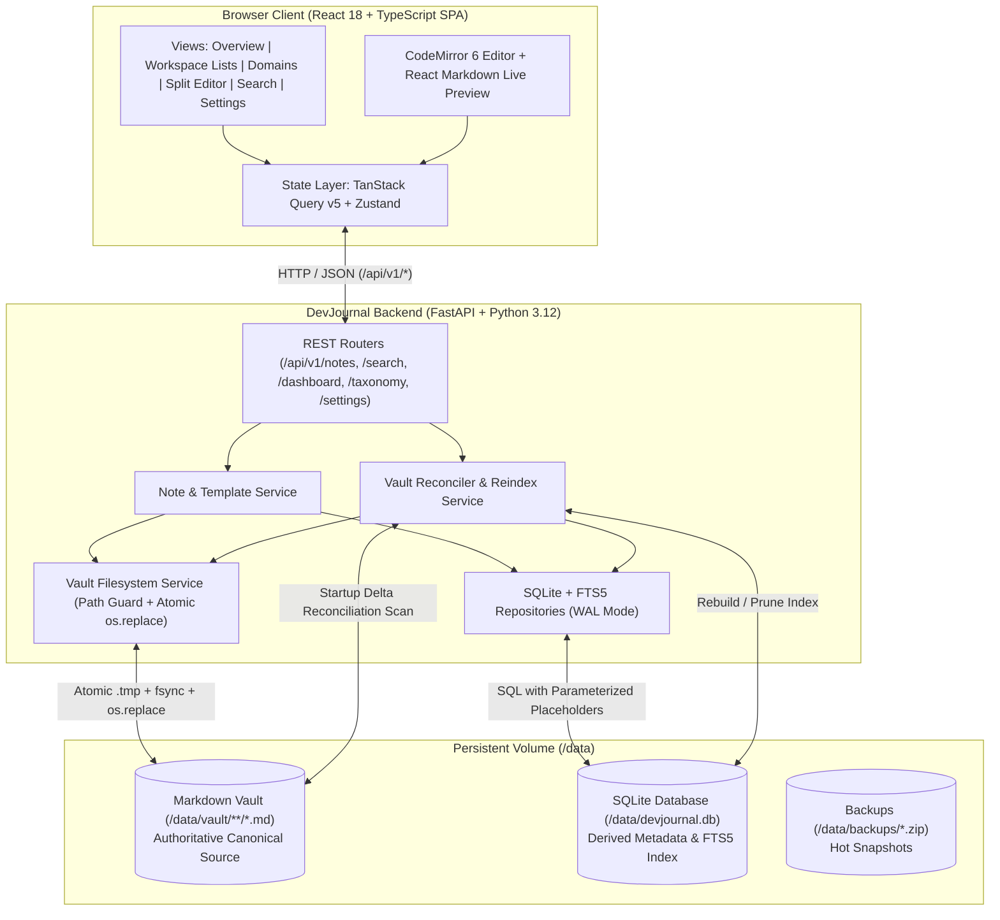

# DevJournal — System Architecture

This document describes the architectural topology, data flow, component responsibilities, and synchronization contracts of **DevJournal** ("Your Personal Engineering Knowledge Base").

---

## 1. Architectural Principles

DevJournal follows a **Layered Monolith** pattern designed for personal, self-hosted deployment on user-controlled hardware (local workstation, homelab server, or cloud-hosted virtual machine with persistent block storage).

1. **Local-First & User-Controlled Storage**: The user retains complete physical control over their notes. The application has zero runtime dependencies on proprietary third-party cloud storage APIs (S3, Dropbox, Notion, Azure Blob REST APIs).
2. **Markdown as the Authoritative Source of Truth**: Every note is physically stored as an individual UTF-8 Markdown (`.md`) file on disk, formatted with deterministic YAML frontmatter. Notes remain human-readable and portable outside DevJournal using standard text editors (Vim, VS Code, Obsidian).
3. **Derived SQLite + FTS5 Index**: SQLite is treated as an ephemeral, derived index for high-speed relational queries, taxonomy aggregation, and BM25 full-text search. The SQLite database can be rebuilt from scratch from the Markdown vault at any time.
4. **Clean Web Monolith**: In production, a single container packaging Python 3.12 (FastAPI) and compiled React 18 assets handles both REST APIs (`/api/v1/*`) and static Single Page Application (SPA) delivery (`/*`), eliminating CORS overhead.

---

## 2. System Topology



---

## 3. Component Responsibilities

### 3.1 Frontend (`frontend/src/`)
- **AppShell & TopBar**: Manages global layout, responsive mobile drawer, desktop 60px collapsed icon rail vs. 240px expanded navigation, breadcrumb generation, and the global search palette (`Ctrl+K`).
- **SidebarNav**: Displays Workspace navigation (6 items), Knowledge Domains (7 items), live active note counts, Settings navigation, and real-time backend health status.
- **NoteWorkspace**: Hosts the two-way bound YAML metadata bar, CodeMirror 6 syntax-highlighted editor, resizable split-panel system (`react-resizable-panels`), debounced live Markdown preview (`150ms` timer debounce), and autosave state indicator.
- **Data & Filter Layer**: Uses TanStack Query v5 for client-side HTTP caching, optimistic updates, background cache invalidation, and debounced filter updates across All Notes and Knowledge Domain views.

### 3.2 Backend API (`backend/app/api/v1/`)
- **`system.py`**: Health checks (`GET /health`), vault reindexing (`POST /reindex`), single-file Markdown upload (`POST /import-md`), hot backups (`POST /backup`), and application preferences (`GET` / `PUT /settings`).
- **`notes.py`**: Complete note lifecycle management (`GET /notes`, `POST /notes`, `GET /notes/{id}`, `PUT /notes/{id}`, `PATCH /notes/{id}`, `DELETE /notes/{id}`, `POST /notes/{id}/restore`, `GET /notes/{id}/export`, and `POST /notes/daily/today`).
- **`dashboard.py`**: Aggregates metric card statistics, 5-workflow quick capture templates, Continue Reading list (`last_opened_at DESC`), and Recently Updated list (`updated_at DESC`).
- **`search.py`**: Executes SQLite FTS5 BM25 queries with `<mark>` highlight snippets, faceted by note type, domain, and tag.
- **`taxonomy.py`**: Returns real-time active note counts grouped by workspace type, domain, tag, and folder.

### 3.3 Storage & Services (`backend/app/services/`)
- **`vault_storage.py`**:
  - Validates and resolves vault-relative paths, strictly rejecting directory traversal attempts (`../`, absolute paths, symlink escapes).
  - Implements atomic writes via temporary sibling files (`.tmp-<uuid>.md`), `os.fsync()`, and `os.replace()`.
  - Implements safe soft-deletion by moving files to `vault/99-Trash/` with original path metadata preserved in frontmatter.
- **`frontmatter_svc.py`**:
  - Parses and serializes YAML frontmatter using PyYAML `safe_load` and `safe_dump`.
  - Normalizes line endings to `\n` (`LF`) before computing SHA-256 content hashes.
  - Gracefully recovers from malformed frontmatter by treating the file as raw Markdown rather than crashing the indexer.
- **`indexer_svc.py`**:
  - Executes single-note write-through updates on API saves.
  - Performs startup delta scans comparing file `(rel_path, st_mtime, content_hash)` against SQLite records.
  - Executes full vault rebuilds (`POST /api/v1/system/reindex`) to reconstitute SQLite from disk.
- **`template_svc.py`**:
  - Supplies the 5 canonical engineering templates (`General Note`, `Experiment`, `Troubleshooting`, `Project`, `Daily Journal`) with pre-populated frontmatter and structured headings.
- **`backup_svc.py`**:
  - Leverages SQLite's native `sqlite3.Connection.backup()` hot snapshot mechanism to archive `devjournal.db` alongside `vault/` into a timestamped `.zip` archive.

---

## 4. Storage Architecture & Synchronization Contract

### 4.1 Authoritative vs. Derived State
The system explicitly distinguishes between **canonical data** (must survive total database loss) and **non-canonical derived data** (convenience cache):

| Property | Canonical Storage Location | Recoverable from Markdown Vault Alone? |
|---|---|---|
| Note ID (UUID) | YAML Frontmatter (`id`) | Yes |
| Title | YAML Frontmatter (`title`) | Yes |
| Note Type | YAML Frontmatter (`type`) | Yes |
| Lifecycle Status | YAML Frontmatter (`status`) | Yes |
| Knowledge Domains | YAML Frontmatter (`domains: [...]`) | Yes |
| Tags | YAML Frontmatter (`tags: [...]`) | Yes |
| Pinned Flag | YAML Frontmatter (`pinned: true/false`) | Yes |
| Soft-Deleted State | YAML Frontmatter (`trashed: true`, `original_rel_path`) | Yes |
| Created & Updated At | YAML Frontmatter (`created_at`, `updated_at`) | Yes |
| Note Body & Headings | Plain Markdown Body | Yes |
| Full-Text Search Index | Derived FTS5 Virtual Table | Yes (Rebuilt during reindex) |
| `last_opened_at` Timestamp | SQLite `notes.last_opened_at` | No (DB-only to prevent disk writes on read) |
| Editor UI Preferences | SQLite `settings` table | No (Preserved via DB backup) |

### 4.2 Write-Then-Index Lifecycle
Filesystem operations and SQLite transactions do **not** form a single distributed transaction. DevJournal enforces consistency through a deterministic **Write-Then-Index** protocol:

```text
[Client: PUT /api/v1/notes/{id}]
               │
               ▼
1. Normalize line endings to LF (\n)
2. Verify optimistic concurrency: hash(existing_disk_bytes) == expected_hash
   └─► If mismatch: Return HTTP 409 Conflict (no disk or DB changes)
               │
               ▼
3. Write to temporary sibling file: vault/<folder>/.tmp-<uuid>.md
4. Flush buffers to disk: os.fsync(fd)
5. Atomic replacement: os.replace(temp_path, target_path)
               │
               ▼
6. Compute SHA-256 content_hash and read file st_mtime
               │
               ▼
7. Open SQLite WAL transaction:
   ├─► UPSERT into notes (id, title, slug, rel_path, content_hash, file_mtime, ...)
   ├─► DELETE + INSERT into note_domains
   ├─► DELETE + INSERT into note_tags
   └─► REFRESH notes_fts virtual table
   └─► COMMIT
               │
               ▼
[Return HTTP 200 OK with NoteDetailResponse]
```

### 4.3 Crash & Inconsistency Recovery
- **If Step 3–5 fails**: The temporary file is unlinked, SQLite is untouched, and the API returns `500 Internal Server Error`.
- **If Step 5 succeeds but the server crashes before Step 7**: The Markdown file safely resides on disk. Upon next server startup (or when manual reindex is triggered), `indexer_svc.py` scans `vault/**/*.md`, notices that the file's `mtime` or `content_hash` differs from SQLite (or is missing), and automatically updates the database.
- **External Edits**: When files are created, modified, or deleted outside the application (e.g. via Vim or Git pull), triggering **Rebuild Index** reconciles the index completely.

---

## 5. Security & Isolation Boundaries

1. **Path Traversal Shield**: The storage service resolves every path and asserts `target_path.resolve().is_relative_to(vault_root.resolve())`. Any path containing `..`, absolute drives, or null bytes raises an immediate `HTTP 400 Bad Request`.
2. **Safe YAML Deserialization**: All frontmatter is parsed strictly with `yaml.safe_load()`. Arbitrary Python object instantiation is impossible.
3. **Markdown XSS Protection**: The preview engine renders via `react-markdown` piped through `rehype-sanitize` using GitHub's sanitized HTML schema, stripping `<script>`, `<iframe>`, `<object>`, `javascript:` URLs, and inline event handlers (`onload`, `onerror`).
4. **Parameterized SQL Queries**: All queries into SQLite and FTS5 use parameterized placeholders (`?`). String concatenation is strictly prohibited.
5. **Network Exposure Policy**: DevJournal MVP is unauthenticated by design for local and private network (Tailscale / WireGuard) access. Public internet exposure requires an authenticating reverse proxy (Caddy, Nginx with Basic Auth, or Cloudflare Access).
