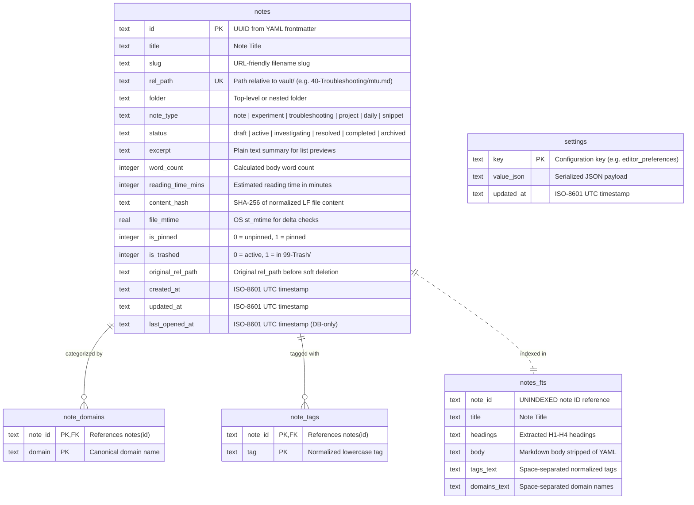

# DevJournal — Database & Storage Design

This document details the SQLite database schema, virtual tables, indexing strategies, full-text search configuration, and reindexing mechanisms used by **DevJournal**.

---

## 1. Database Configuration & Pragmas

DevJournal utilizes an embedded SQLite 3 database located at `/data/devjournal.db` (or `./devjournal-data/devjournal.db` during local development).

On every database connection checkout, the following PRAGMAs are executed:

```sql
PRAGMA journal_mode = WAL;
PRAGMA synchronous = NORMAL;
PRAGMA foreign_keys = ON;
PRAGMA busy_timeout = 5000;
```

### Rationale
- **`journal_mode = WAL`**: Write-Ahead Logging allows concurrent readers to proceed uninterrupted while a write transaction is executing. It dramatically improves responsiveness under simultaneous background indexing and UI queries.
- **`synchronous = NORMAL`**: In WAL mode, `NORMAL` guarantees data integrity across power losses and OS crashes while avoiding excessive disk flushes on every SQLite transaction.
- **`foreign_keys = ON`**: Enforces relational cascades (e.g., deleting a note automatically cascades to remove its junction rows in `note_domains` and `note_tags`).
- **`busy_timeout = 5000`**: Prevents immediate `SQLITE_BUSY` errors under write contention by waiting up to 5,000 milliseconds for locks to clear.

---

## 2. Entity-Relationship Diagram



---

## 3. Core Tables & DDL Specification

```sql
-- 1. Core Note Metadata Index
CREATE TABLE IF NOT EXISTS notes (
    id TEXT PRIMARY KEY,
    title TEXT NOT NULL,
    slug TEXT NOT NULL,
    rel_path TEXT NOT NULL UNIQUE,
    folder TEXT NOT NULL,
    note_type TEXT NOT NULL DEFAULT 'note',
    status TEXT,
    excerpt TEXT NOT NULL DEFAULT '',
    word_count INTEGER NOT NULL DEFAULT 0,
    reading_time_mins INTEGER NOT NULL DEFAULT 1,
    content_hash TEXT NOT NULL,
    file_mtime REAL NOT NULL,
    is_pinned INTEGER NOT NULL DEFAULT 0,
    is_trashed INTEGER NOT NULL DEFAULT 0,
    original_rel_path TEXT,
    created_at TEXT NOT NULL,
    updated_at TEXT NOT NULL,
    last_opened_at TEXT
);

-- Indexing Strategy for Fast Filtering & Sorting
CREATE INDEX IF NOT EXISTS idx_notes_type_trashed 
    ON notes(note_type, is_trashed, updated_at DESC);

CREATE INDEX IF NOT EXISTS idx_notes_folder_trashed 
    ON notes(folder, is_trashed);

CREATE INDEX IF NOT EXISTS idx_notes_updated 
    ON notes(is_trashed, is_pinned DESC, updated_at DESC);

CREATE INDEX IF NOT EXISTS idx_notes_last_opened 
    ON notes(last_opened_at DESC) 
    WHERE is_trashed = 0 AND last_opened_at IS NOT NULL;

-- 2. Knowledge Domains Junction Table (Many-to-Many)
CREATE TABLE IF NOT EXISTS note_domains (
    note_id TEXT NOT NULL REFERENCES notes(id) ON DELETE CASCADE,
    domain TEXT NOT NULL,
    PRIMARY KEY (note_id, domain)
);
CREATE INDEX IF NOT EXISTS idx_note_domains_domain 
    ON note_domains(domain, note_id);

-- 3. Normalized Tags Junction Table (Many-to-Many)
CREATE TABLE IF NOT EXISTS note_tags (
    note_id TEXT NOT NULL REFERENCES notes(id) ON DELETE CASCADE,
    tag TEXT NOT NULL,
    PRIMARY KEY (note_id, tag)
);
CREATE INDEX IF NOT EXISTS idx_note_tags_tag 
    ON note_tags(tag, note_id);

-- 4. Application Settings (Key-Value Configuration)
CREATE TABLE IF NOT EXISTS settings (
    key TEXT PRIMARY KEY,
    value_json TEXT NOT NULL,
    updated_at TEXT NOT NULL
);

-- 5. SQLite FTS5 Full-Text Search Virtual Table
CREATE VIRTUAL TABLE IF NOT EXISTS notes_fts USING fts5(
    note_id UNINDEXED,
    title,
    headings,
    body,
    tags_text,
    domains_text,
    tokenize = 'porter unicode61 remove_diacritics 2'
);
```

---

## 4. Full-Text Search & BM25 Ranking Strategy

### 4.1 Tokenizer Configuration
The FTS5 virtual table utilizes:
- **`unicode61`**: Normalizes Unicode characters and case-folds words uniformly across languages.
- **`remove_diacritics 2`**: Strips accents and diacritical marks (e.g., searching for `resume` matches `résumé`).
- **`porter`**: Standard English stemming tokenizer (e.g., searching for `configuring` matches `configured` and `configuration`).

### 4.2 Column Weights & Ranking
When querying `/api/v1/search?q=<query>`, the backend computes relevance ranking using SQLite's built-in `bm25()` function with weighted column coefficients:

```sql
SELECT 
    n.id,
    n.title,
    n.slug,
    n.rel_path,
    n.folder,
    n.note_type,
    n.status,
    n.is_pinned,
    n.updated_at,
    snippet(notes_fts, 3, '<mark>', '</mark>', '...', 24) AS snippet_text,
    bm25(notes_fts, 10.0, 5.0, 1.0, 3.0, 2.0) AS score
FROM notes_fts
JOIN notes n ON n.id = notes_fts.note_id
WHERE notes_fts MATCH ? AND n.is_trashed = 0
ORDER BY score ASC, n.updated_at DESC
LIMIT ?;
```

**Weight Breakdown**:
- `title` weight = **10.0** (matches in note titles appear at the top).
- `headings` weight = **5.0** (matches in `##` headings score higher than body text).
- `tags_text` weight = **3.0** (explicit tag matches rank prominently).
- `domains_text` weight = **2.0** (matching knowledge domains).
- `body` weight = **1.0** (general prose content matches).

---

## 5. Reindexing & Disaster Recovery

### 5.1 Reindex Protocol (`POST /api/v1/system/reindex`)
Triggering a reindex initiates a complete reconciliation between `vault/**/*.md` and `devjournal.db`:

1. Begins a database transaction.
2. Reads existing non-canonical timestamps: `SELECT id, last_opened_at FROM notes WHERE last_opened_at IS NOT NULL`.
3. Truncates derived tables:
   - `DELETE FROM notes_fts;`
   - `DELETE FROM note_domains;`
   - `DELETE FROM note_tags;`
   - `DELETE FROM notes;`
4. Recursively walks the physical directory `vault/`:
   - Inspects every file with a `.md` extension (excluding `.tmp-*` files).
   - Parses YAML frontmatter via `frontmatter_svc.py`.
   - Inserts the normalized record into `notes` (reapplying preserved `last_opened_at` if the note ID matches).
   - Populates `note_domains`, `note_tags`, and inserts tokens into `notes_fts`.
5. Commits the transaction and returns `{ "indexed": N, "removed": M, "duration_ms": T }`.

### 5.2 Canonical vs. Non-Canonical Recovery Matrix

| Scenario | Vault Markdown Files (`vault/`) | SQLite Database (`devjournal.db`) | Recovery Outcome |
|---|---|---|---|
| **Database deleted or corrupted** | Intact | Lost | Rebuild completes in < 3s; 100% of notes, tags, domains, and search capabilities restored. UI preferences reset to defaults. |
| **New files added via Git / CLI** | New `.md` files present | Outdated | Reindex or server startup scan indexes all new files automatically. |
| **Full Host Migration** | Backed up via `.zip` | Backed up via `.zip` | Full restoration of all canonical notes, search index, and non-canonical settings. |
