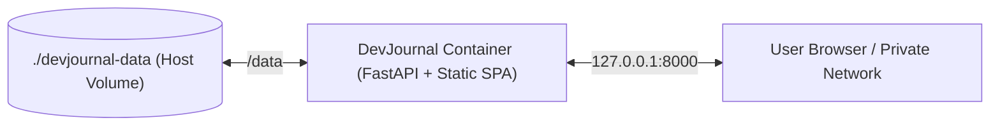

# DevJournal — Deployment & Operations Guide

This document describes the containerized deployment architecture, Docker Compose orchestration, persistent storage management, backup/restore procedures, and security configurations for **DevJournal**.

---

## 1. Deployment Topology

In production, DevJournal runs as a **single, unified container** using a multi-stage Docker build:

1. **Build Stage (`node:22-alpine`)**: Compiles TypeScript and packages the React SPA into static web assets (`frontend/dist/`).
2. **Runtime Stage (`python:3.12-slim`)**: Installs FastAPI backend dependencies alongside `curl` and `tzdata` (IANA timezone database), mounts the compiled frontend assets, and launches the single-worker production Uvicorn server (`--workers 1`) on port `8000`.
3. **Persistent Volume (`/data`)**: Hosts the canonical Markdown vault (`/data/vault/`), the SQLite database (`/data/devjournal.db`), and timestamped hot backup archives (`/data/backups/`).



---

## 2. Docker Compose Configuration

### 2.1 Multi-Stage `Dockerfile`

Create `Dockerfile` in the root repository directory:

```dockerfile
# Stage 1: Build Frontend Assets
FROM node:22-alpine AS frontend-builder
WORKDIR /build
COPY frontend/package*.json ./
RUN npm ci
COPY frontend/ ./
RUN npm run build

# Stage 2: Production Python Runtime
FROM python:3.12-slim AS runtime
WORKDIR /app

# Install system dependencies (curl for healthcheck, tzdata for IANA ZoneInfo)
RUN apt-get update && apt-get install -y --no-install-recommends \
    curl \
    tzdata \
    && rm -rf /var/lib/apt/lists/*

# Install Python dependencies
COPY backend/requirements.txt ./
RUN pip install --no-cache-dir -r requirements.txt

# Copy backend code and built frontend assets
COPY backend/app/ ./app/
COPY --from=frontend-builder /build/dist/ ./frontend-dist/

# Set production environment variables
ENV DEVJOURNAL_DATA_DIR=/data \
    DEVJOURNAL_FRONTEND_DIST_DIR=/app/frontend-dist \
    DEVJOURNAL_LOG_LEVEL=INFO \
    DEVJOURNAL_TIMEZONE=UTC \
    PYTHONUNBUFFERED=1

EXPOSE 8000

# Health check
HEALTHCHECK --interval=30s --timeout=5s --start-period=5s --retries=3 \
  CMD curl -f http://127.0.0.1:8000/api/v1/system/health || exit 1

CMD ["uvicorn", "app.main:app", "--host", "0.0.0.0", "--port", "8000", "--workers", "1"]
```

### 2.2 `docker-compose.yml`

Create `docker-compose.yml` in the root repository directory:

```yaml
services:
  devjournal:
    build:
      context: .
      dockerfile: Dockerfile
    container_name: devjournal
    restart: unless-stopped
    ports:
      # By default, bind to localhost only for security
      - "127.0.0.1:8000:8000"
    environment:
      - DEVJOURNAL_DATA_DIR=/data
      - DEVJOURNAL_LOG_LEVEL=INFO
      - DEVJOURNAL_TIMEZONE=UTC
    volumes:
      # Mount host directory for complete data persistence
      - ./devjournal-data:/data
    healthcheck:
      test: ["CMD", "curl", "-f", "http://127.0.0.1:8000/api/v1/system/health"]
      interval: 30s
      timeout: 5s
      retries: 3
```

---

## 3. Quickstart Deployment

1. Clone or copy the DevJournal repository onto your server.
2. Launch the container stack:
   ```bash
   docker compose up -d --build
   ```
3. Inspect container logs:
   ```bash
   docker compose logs -f devjournal
   ```
4. Access the application in your browser:
   `http://127.0.0.1:8000`

---

## 4. Environment Variables Reference

| Variable | Default Value | Description |
|---|---|---|
| `DEVJOURNAL_DATA_DIR` | `/data` (in container) | Root directory containing `vault/`, `devjournal.db`, and `backups/`. |
| `DEVJOURNAL_FRONTEND_DIST_DIR` | `/app/frontend-dist` | Filesystem location of compiled React SPA assets. |
| `DEVJOURNAL_LOG_LEVEL` | `INFO` | Python logging level (`DEBUG`, `INFO`, `WARNING`, `ERROR`). |
| `DEVJOURNAL_TIMEZONE` | `UTC` | IANA timezone name used when resolving "today" for Daily Journal entries (e.g., `America/New_York`, `Asia/Jakarta`). |
| `DEVJOURNAL_CORS_ORIGINS` | `["http://localhost:5173", "http://localhost:8000"]` | Allowed CORS origins (JSON array). |

---

## 5. Backup & Disaster Recovery Runbook

### 5.1 Hot Backup (While Running)
You can take a hot snapshot without stopping the application in two ways:

1. **Via UI**: Navigate to **Settings $\rightarrow$ Backup, Restore & Markdown Import** and click **Create & Download Backup**.
2. **Via API**:
   ```bash
   curl -X POST http://127.0.0.1:8000/api/v1/system/backup
   ```
   This invokes SQLite's native `sqlite3.Connection.backup()` under `db_write_lock` to create a transactionally consistent copy of `devjournal.db` alongside `backup-manifest.json` (with SHA-256 checksums) and `vault/` inside a timestamped `.zip` file in `./devjournal-data/backups/`.

### 5.2 Cold Backup (Filesystem Sync)
To backup your vault directly using standard Linux utilities (e.g., `rsync`, `rclone`, or Git):

```bash
# Sync vault to off-site backup storage
rsync -avz ./devjournal-data/vault/ /backup/devjournal-vault/
```

### 5.3 Disaster Recovery Procedure
If your server hardware fails or `devjournal.db` is corrupted:

1. Deploy DevJournal on a fresh machine.
2. Restore the `./devjournal-data/vault/` directory containing your `.md` files.
3. Start the container:
   ```bash
   docker compose up -d
   ```
4. The backend startup reconciler will automatically detect all Markdown notes on disk and rebuild `devjournal.db` and the FTS5 search index from scratch.

---

## 6. Network Exposure & Security Best Practices

> [!CAUTION]
> **Do Not Expose Directly to the Public Internet Without Authentication**  
> DevJournal MVP does not include built-in multi-user authentication. It is designed for single-user personal knowledge management. If you need remote access, use one of the two supported patterns below.

### Pattern A: Private Network / VPN (Recommended)
Access your self-hosted server using a zero-trust mesh VPN such as **Tailscale** or **WireGuard**:
- Run Tailscale on your server and client devices.
- Bind DevJournal to the Tailscale IP or localhost.
- Access DevJournal remotely over an encrypted VPN tunnel without opening public firewall ports.

### Pattern B: Authenticated Reverse Proxy
If you require domain-based access over HTTPS, place DevJournal behind an authenticating reverse proxy:

#### Example Caddy Configuration with Basic Authentication
```caddy
notes.yourdomain.com {
    # Protect with HTTP Basic Authentication
    basicauth / {
        admin $2a$14$ZkhxVvQ8Q/7p7e9...
    }

    # Proxy to DevJournal container
    reverse_proxy 127.0.0.1:8000
}
```

Alternatively, use **Cloudflare Access (Zero Trust)** or **Authelia / OAuth2-Proxy** in front of the container to require Google, GitHub, or Passkey authentication before granting access.
