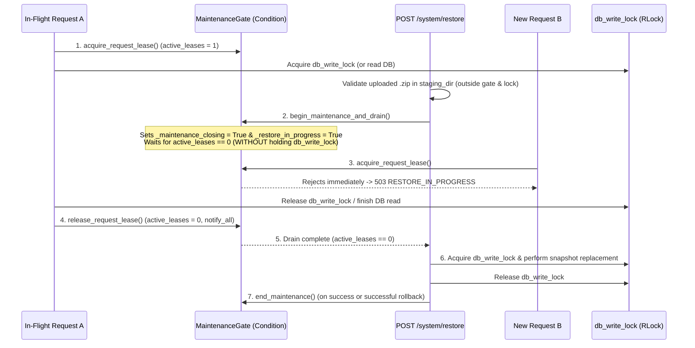
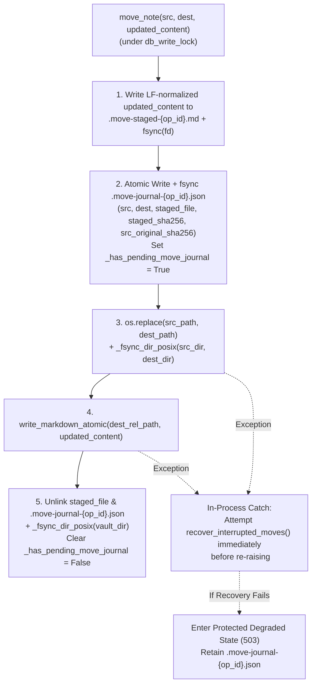

# DevJournal — Phase 1 Development Plan: Backend REST API, Frontend Integration & Production Packaging

> [!IMPORTANT]
> **Plan Status**: Final Approved Baseline Specification (Plan-Only Revision). No application source files have been modified. Implementation of Milestones **M1 → M6** will begin only after explicit project-owner approval of this final plan.

---

## 1. Executive Summary & Architectural Invariants

Phase 0 established and verified the core storage foundation of **DevJournal** (38 passing backend unit/integration tests across SQLite WAL initialization, `VaultStorageService`, `frontmatter_svc`, `NotesRepository`, `IndexerService`, and `/api/v1/system/health` + `/api/v1/system/reindex`).

Phase 1 completes the application by implementing the remaining **20 REST API endpoints** (bringing the total to **22 routes** under `/api/v1`), connecting all 6 React 18 frontend views to live backend state via TanStack Query v5, integrating the CodeMirror 6 split-pane Markdown workspace with debounced live preview and resilient autosave/draft recovery, and packaging the unified monolith in a production multi-stage Docker image.

### 1.1 Preserved Phase 0 Contracts
1. **Canonical Markdown Vault as Source of Truth**:
   - Every note lives physically as a UTF-8 `.md` file with YAML frontmatter inside one of the 8 canonical vault folders (`00-Inbox`, `10-Notes`, `20-Projects`, `30-Experiments`, `40-Troubleshooting`, `50-Snippets`, `90-Daily`, `99-Trash`).
   - Physical folder location is authoritative for trash state (`folder == "99-Trash"` $\iff$ `trashed = True`).
2. **Derived SQLite + FTS5 Index**:
   - `devjournal.db` (WAL mode, `synchronous = NORMAL`, `foreign_keys = ON`, `busy_timeout = 5000`) and `notes_fts` (FTS5 virtual table with `porter unicode61 remove_diacritics 2`) serve as a rebuildable relational and search index.
   - Only `settings` (under canonical key `'editor_preferences'`) and `notes.last_opened_at` are DB-only state; both are preserved across `full_reindex()` and hot backup/restore snapshots.
3. **Write-Then-Index Consistency**:
   - All mutations acquire the in-process re-entrant write lock (`db_write_lock = threading.RLock()`), write the canonical Markdown file atomically via sibling `.tmp-<uuid>.md` + `os.fsync()` + `os.replace()`, and immediately update SQLite + FTS5 in an atomic `BEGIN IMMEDIATE` transaction (`get_db_transaction()`).
4. **Single-Worker Concurrency Model**:
   - Production Uvicorn runs with `--workers 1` so `db_write_lock` and the in-process request-lease maintenance gate coordinate all vault and SQLite operations deterministically.
5. **Zero Unnecessary Dependencies**:
   - Backend uses existing packages in `backend/requirements.txt` (`fastapi`, `uvicorn[standard]`, `pydantic`, `pydantic-settings`, `python-frontmatter`, `pyyaml`, `python-multipart`, `pytest`, `pytest-asyncio`, `httpx`).
   - Frontend uses existing packages in `frontend/package.json` (`@tanstack/react-query`, `zustand`, `@codemirror/*`, `react-markdown`, `remark-gfm`, `rehype-sanitize`, `rehype-highlight`, `react-resizable-panels`, `lucide-react`, `clsx`, `tailwind-merge`).

---

## 2. Engineering Specifications & Final Review Resolutions

### 2.1 Complete Snapshot Backup, Required Manifest, Request-Draining Maintenance Gate & Crash-Recoverable Restore

#### 2.1.1 Coordinated Size & Entry Guarantees (`P1-1`, `P0-3`)
To guarantee that **every backup archive produced by `POST /api/v1/system/backup` can be restored by `POST /api/v1/system/restore`**, identical structural and size limits are enforced by **both** the backup generator and the restore validator in `BackupService`:
- `MAX_BACKUP_NOTE_FILES = 10_000`: Maximum number of `.md` files in `vault/`.
- `MAX_ARCHIVE_ENTRIES = 10_050`: Maximum total `ZipInfo` entries in the `.zip` archive (covering up to `10,000` `.md` files + `backup-manifest.json` + `devjournal.db` + `vault/` + 8 canonical folder entries + optional nested directories).
- `MAX_UNCOMPRESSED_BYTES = 250 * 1024 * 1024` (**250 MiB**): Maximum combined uncompressed byte size of `vault/**/*.md` + `devjournal.db` + `backup-manifest.json`.
- `MAX_COMPRESSED_UPLOAD_BYTES = 260 * 1024 * 1024` (**260 MiB**): Maximum compressed `.zip` file size.

**Backup-Side Enforcement (`create_backup`)**:
1. While walking `vault/` and snapshotting `devjournal.db` under `db_write_lock`, `create_backup()` tracks `note_file_count`, `total_zip_entries` (including directory entries), and `total_uncompressed_bytes`. If `note_file_count > MAX_BACKUP_NOTE_FILES`, `total_zip_entries > MAX_ARCHIVE_ENTRIES`, or `total_uncompressed_bytes > MAX_UNCOMPRESSED_BYTES`, backup creation aborts immediately before finalizing the archive.
2. After writing, flushing, and calling `os.fsync(fd)` on `temp_zip = settings.backups_dir / f".tmp-backup-{op_id}.zip"`, `create_backup()` checks `temp_zip.stat().st_size <= MAX_COMPRESSED_UPLOAD_BYTES`.
3. If **any** limit is exceeded (or any error occurs), `temp_zip` and `temp_db` are unlinked in the `finally:` block without ever calling `os.replace(temp_zip, final_zip_path)`, and `PayloadTooLargeError` is raised (`413 Content Too Large`).

#### 2.1.2 Lock-Protected Backup Format, Required Manifest & Atomic Finalization (`POST /api/v1/system/backup`)
1. **In-Process Lock Boundary**:
   - `BackupService.create_backup()` acquires a request lease (or runs inside maintenance during pre-restore backup) and executes inside `with db_write_lock:` so no in-process write transaction interleaves between `src_conn.backup(dst_conn)` and the `vault/` read.
   - *Out-of-Band Boundary Note*: Direct external OS edits to `vault/` during a hot backup are outside the in-process lock boundary and are reconciled on the next `reconcile_vault()` or `full_reindex()`.
2. **Required `backup-manifest.json` & Explicit Archive Member Allowlist (Format Version 1)**:
   - Every backup archive is a complete full-snapshot `.zip` containing **only** members matching the strict allowlist below:
     1. `backup-manifest.json` (required root file):
        ```json
        {
          "format_version": 1,
          "created_at": "2026-11-04T12:00:00Z",
          "app_version": "0.1.0",
          "note_file_count": 42,
          "total_uncompressed_bytes": 1048576,
          "db_sha256": "<64-char lowercase hex sha256 of devjournal.db>",
          "files": {
            "vault/10-Notes/wireguard-mtu.md": "<64-char lowercase hex sha256>"
          }
        }
        ```
     2. `devjournal.db` (required root file, hot-snapshotted via `sqlite3.Connection.backup()`).
     3. Directory entries `vault/` and `vault/<canonical_folder>/` (plus optional nested subdirectory entries `vault/<canonical_folder>/<subpath>/`) where `<canonical_folder>` $\in$ `CANONICAL_VAULT_FOLDERS`.
     4. Canonical Markdown files `vault/<canonical_folder>/.../<filename>.md` where `<canonical_folder>` $\in$ `CANONICAL_VAULT_FOLDERS`, no path segment starts with `.`, and suffix is `.md`.
3. **Valid Empty-Vault Backup Behavior**:
   - When the vault contains `0` notes, `create_backup()` produces a valid full-snapshot archive containing `backup-manifest.json` (`"note_file_count": 0`, `"files": {}`, `"total_uncompressed_bytes": <size of devjournal.db>`), `devjournal.db`, and the 8 empty canonical folder entries `vault/<folder>/`.
4. **Atomic Backup Archive Finalization & Filename Validation (`P1-5`)**:
   - `create_backup()` snapshots SQLite to `temp_db = settings.backups_dir / f".tmp-db-{op_id}.db"`, writes `temp_zip = settings.backups_dir / f".tmp-backup-{op_id}.zip"`, flushes and calls `os.fsync(fd)` before closing, verifies compressed size `<= MAX_COMPRESSED_UPLOAD_BYTES`, atomically promotes via `os.replace(temp_zip, final_zip_path)`, calls `_fsync_dir_posix(settings.backups_dir)`, and removes `.tmp-*` files in `finally:`.
   - Standard backups use `devjournal-backup-YYYYMMDD-HHMMSS.zip` (or `devjournal-backup-YYYYMMDD-HHMMSS-{op_id[:8]}.zip` on same-second collision); pre-restore safety backups use `devjournal-backup-YYYYMMDD-HHMMSS-pre-restore-{op_id[:8]}.zip`.
   - `GET /api/v1/system/backups/{filename}` validates `filename` against:
     ```python
     BACKUP_FILENAME_RE = re.compile(
         r"^devjournal-backup-\d{8}-\d{6}(?:-[a-f0-9]{8}|-pre-restore-[a-f0-9]{8})?\.zip$"
     )
     ```
     It rejects path separators (`/`, `\`), `..`, or NUL bytes (`400 INVALID_BACKUP_FILENAME`), verifies `resolved.parent == settings.backups_dir.resolve()` and `not resolved.is_symlink()`, and serves the file as `application/zip`.

#### 2.1.3 Restore Maintenance Gate with Active-Request Draining (`P0-1`)
To ensure that neither newly arriving requests nor **already-running in-flight requests** can observe or mutate partially restored state—while guaranteeing zero deadlocks with `db_write_lock`—`backend/app/db/connection.py` implements `MaintenanceGate` using a `threading.Condition`:



1. **Synchronization State (`MaintenanceGate`)**:
   - `_cond = threading.Condition(threading.Lock())`
   - `_active_leases: int = 0` (number of in-flight non-health API requests currently executing)
   - `_maintenance_closing: bool = False` (closes admission to new requests while waiting for active leases to drain)
   - `_restore_in_progress: bool = False` (true from maintenance start until commit or successful rollback)
   - `_degraded_reason: str | None = None` (set if restore rollback or move-journal recovery fails; keeps gate closed in protected degraded state)
2. **Lifecycle & Deadlock-Free Lock Ordering**:
   - **Rule 1 — Request Admission Lease (`acquire_request_lease`)**:
     - FastAPI middleware wraps every `/api/v1/*` request **except** `GET /api/v1/system/health` and `POST /api/v1/system/restore` in `with maintenance_gate.acquire_request_lease():`.
     - Inside `with self._cond:`: if `self._maintenance_closing or self._restore_in_progress or self._degraded_reason is not None`, immediately raises `RestoreInProgressError` (`503 RESTORE_IN_PROGRESS`, `Retry-After: 2`). Otherwise increments `self._active_leases += 1`.
     - On exit (`finally:`), acquires `with self._cond:`, decrements `self._active_leases -= 1`, and if `self._active_leases == 0`, calls `self._cond.notify_all()`.
   - **Rule 2 — Restore Admission, Closing & Draining (`begin_maintenance_and_drain`)**:
     - `POST /api/v1/system/restore` performs Step 1 (streaming upload) and Step 2 (staging & manifest/DB validation) before activating maintenance. (Under `with self._cond:`, if another restore is already active or `_degraded_reason` is set, it immediately raises `RestoreInProgressError` -> `503`).
     - When ready for Step 3, Restore calls `maintenance_gate.begin_maintenance_and_drain(timeout=30.0)` **before** acquiring `db_write_lock`:
       - Inside `with self._cond:`, sets `self._maintenance_closing = True` and `self._restore_in_progress = True` (blocking all new request leases atomically), then waits on `self._cond.wait_for(lambda: self._active_leases == 0, timeout=timeout)`.
       - Because Restore does **not** hold `db_write_lock` while waiting for `_active_leases == 0`, any already-admitted request that needs `db_write_lock` to finish can acquire and release `db_write_lock` normally and then release its request lease—**making deadlocks between request leases and `db_write_lock` impossible**.
       - If draining times out (`_active_leases > 0` after `timeout`), clears `_maintenance_closing = False` and `_restore_in_progress = False`, cleans up `staging_dir`, and returns `503 RESTORE_IN_PROGRESS` without touching live data.
   - **Rule 3 — Exclusive Execution & Release**:
     - Once `_active_leases == 0`, Restore acquires `with db_write_lock:` and executes Steps 3–5 with zero concurrent readers or writers in flight.
     - Upon successful Step 4d commit or successful Step 5 rollback, `maintenance_gate.end_maintenance()` clears `_maintenance_closing = False` and `_restore_in_progress = False`.
     - If rollback itself fails, `maintenance_gate.mark_degraded(reason)` keeps the gate closed (`503 RESTORE_IN_PROGRESS` on all data routes; `status: "degraded"` on `GET /api/v1/system/health`).
3. **Health Endpoint Behavior (`GET /api/v1/system/health`)**:
   - Always exempt from request-lease blocking: returns `status: "maintenance"` when `_restore_in_progress is True`, `status: "degraded"` when `_degraded_reason is not None` (or when vault/DB checks fail), and `status: "ok"` during normal operation.

#### 2.1.4 Journaled, Crash-Recoverable Full Snapshot Restore & Rollback Safety (`P0-1`, `P0-3`, `P1-4`)
> [!WARNING]
> **No False "Atomic Directory Replacement" Assumption**: Replacing files across 8 canonical folders and updating SQLite is a multi-step sequence, not a single atomic OS syscall. DevJournal coordinates restore with the **request-draining maintenance gate + durable recovery journal (`.restore-journal.json`) + pre-restore rollback directory (`.restore-rollback-{id}`) + fail-closed startup recovery**.

1. **Step 1 — Streaming Upload, Member Allowlist & Required Manifest Check**:
   - Streams upload in `64 KiB` chunks enforcing `MAX_COMPRESSED_UPLOAD_BYTES` (**260 MiB**; `413` on overflow).
   - Validates ZIP structure (`zipfile.BadZipFile` $\rightarrow$ `400 INVALID_ARCHIVE`).
   - Enforces `len(zf.infolist()) <= MAX_ARCHIVE_ENTRIES` (`10,050`).
   - Validates every member path: rejects `..`, leading `/` or `\`, drive prefixes (`C:`), NUL bytes, symlinks (`0o120000`), and duplicate normalized POSIX paths.
   - Enforces the **Archive Member Allowlist** (`"backup-manifest.json"`, `"devjournal.db"`, `"vault/"`, `"vault/<canonical_folder>/..."` directory, or `"vault/<canonical_folder>/.../<name>.md"`). Unknown root or non-`.md` members raise `InvalidInputError("INVALID_ARCHIVE", ...)` (`400`).
   - Requires both `"backup-manifest.json"` and `"devjournal.db"` at the archive root (`400 INVALID_ARCHIVE` if missing).
2. **Step 2 — Isolated Staging, SHA-256 Digest Verification & DB Integrity Check**:
   - Extracts members into `staging_dir = settings.data_dir / f".restore-stage-{op_id}"` while counting actual decompressed bytes (`<= 250 MiB`) and computing SHA-256 digests of `devjournal.db` and every `vault/**/*.md` file.
   - Parses `staging_dir / "backup-manifest.json"` and verifies:
     - `format_version == 1`.
     - `note_file_count == len(extracted_md_files) <= 10_000`.
     - `total_uncompressed_bytes == actual_db_plus_md_uncompressed_bytes <= 250 * 1024 * 1024`.
     - `db_sha256 == actual_db_sha256`.
     - `manifest["files"]` keys exactly equal the set of extracted `vault/**/*.md` paths, and every file's SHA-256 digest matches `manifest["files"][rel_path]`.
   - Verifies `staging_dir / "devjournal.db"` starts with `b"SQLite format 3\x00"`, runs `PRAGMA integrity_check;` (`== "ok"`), and reads `snapshot_settings` and `snapshot_last_opened`.
   - Validates every staged `.md` file is valid UTF-8. On any failure in Step 1 or Step 2, removes `staging_dir` and returns `400 INVALID_ARCHIVE` before closing the maintenance gate.
3. **Step 3 — Request Draining, Lock Acquisition, Rollback Snapshot & Durable Journal**:
   - Calls `maintenance_gate.begin_maintenance_and_drain()` (waits until `_active_leases == 0`, blocking new requests with `503 RESTORE_IN_PROGRESS`), then acquires `with db_write_lock:`.
   - Ensures any pending move journals are recovered first via `vault_storage.recover_interrupted_moves()`.
   - Creates the pre-restore safety backup `safety_zip = settings.backups_dir / f"devjournal-backup-{ts}-pre-restore-{op_id[:8]}.zip"` (flushed, `os.fsync`ed, renamed, and `_fsync_dir_posix(settings.backups_dir)`).
   - Populates `rollback_dir = settings.data_dir / f".restore-rollback-{op_id}"`:
     - Copies live SQLite DB via `live_conn.backup(rollback_conn)` to `rollback_dir / "devjournal.db"` (`os.fsync`ed).
     - Copies all live `.md` files into `rollback_dir / "vault"` using `write_markdown_atomic` (with `os.fsync` and `_fsync_dir_posix`).
   - Writes `.restore-journal.json` via sibling `.tmp-journal-{op_id}.json` $\rightarrow$ `os.fsync(fd)` $\rightarrow$ `os.replace` $\rightarrow$ `_fsync_dir_posix(settings.data_dir)`.
4. **Step 4 — Multi-Stage Live Replacement (Stages 4a–4d)**:
   - **Stage 4a (Vault Replacement)**: Ensures all 8 canonical folders exist, unlinks `.md` files in `settings.vault_dir` absent from `staging_dir / "vault"`, writes all staged `.md` files via `write_markdown_atomic`, and calls `_fsync_dir_posix` on every modified canonical folder.
   - **Stage 4b (Settings Replacement)**: In `get_db_transaction()`, runs `DELETE FROM settings;` and inserts `snapshot_settings`.
   - **Stage 4c (Full Reindex)**: Runs `IndexerService().full_reindex()`.
   - **Stage 4d (`last_opened_at` Restoration)**: In `get_db_transaction()`, resets `UPDATE notes SET last_opened_at = NULL;` and restores `snapshot_last_opened` by note ID.
5. **Step 5 — Rollback & Rollback-Failure Preservation (`P1-4`)**:
   - If Stages 4a–4d succeed: unlinks `.restore-journal.json`, calls `_fsync_dir_posix(settings.data_dir)`, removes `staging_dir` and `rollback_dir`, calls `maintenance_gate.end_maintenance()`, and returns `200 OK` (`RestoreResponse`).
   - If any exception `restore_exc` occurs during Stages 4a–4d:
     - Atomically updates `.restore-journal.json` to `"stage": "ROLLING_BACK"` (`os.fsync` + `_fsync_dir_posix`).
     - Executes `_rollback_from_directory(rollback_dir)`: restores all `.md` files in `settings.vault_dir` from `rollback_dir / "vault"`, restores `settings.db_path` from `rollback_dir / "devjournal.db"` via `rollback_conn.backup(live_conn)`, and runs `IndexerService().reconcile_vault()`.
     - **If `_rollback_from_directory()` succeeds**: unlinks `.restore-journal.json`, calls `_fsync_dir_posix(settings.data_dir)`, removes `staging_dir` and `rollback_dir`, calls `maintenance_gate.end_maintenance()`, and re-raises `restore_exc`.
     - **If `_rollback_from_directory()` itself fails (`rollback_exc`)**:
       - **Never removes `.restore-journal.json`, `rollback_dir`, or `safety_backup_filename`!**
       - Calls `maintenance_gate.mark_degraded(str(rollback_exc))` so the `503 RESTORE_IN_PROGRESS` gate remains active and `GET /system/health` reports `status: "degraded"`.
6. **Step 6 — Fail-Closed Startup Recovery (`recover_interrupted_restore_if_any`)**:
   - Invoked in `backend/app/main.py` `lifespan()` before `IndexerService().reconcile_vault()`.
   - If `.restore-journal.json` exists: attempts `_rollback_from_directory(rollback_dir)` (or falls back to extracting `safety_backup_filename` from `settings.backups_dir`).
   - Only after rollback and `full_reindex()` succeed does it unlink `.restore-journal.json` (`_fsync_dir_posix(settings.data_dir)`) and remove `staging_dir` / `rollback_dir`.
   - **Fail-Closed Startup Rule (`P1-4`)**: If startup recovery cannot complete, it retains `.restore-journal.json`, `rollback_dir`, and `safety_backup_filename`, marks the maintenance gate degraded, logs `CRITICAL`, and **raises `RuntimeError` to abort application startup**.

---

### 2.2 Crash-Safe Move + Update & Runtime Recovery (`P0-2`)
In `VaultStorageService.move_note(src_rel_path, dest_rel_path, updated_content=...)`, executing `os.replace(src_path, dest_path)` followed by `write_markdown_atomic(dest_rel_path, updated_content)` prevents duplicate files at source and destination, **but** a failure or crash between `os.replace()` and `write_markdown_atomic()` leaves `dest_path` holding the **old content**.

To guarantee that interrupted moves are recovered **before any subsequent runtime request can observe an inconsistent path or stale content**—without embedding arbitrarily large Markdown bodies inside JSON or overwriting unrelated files:



1. **Staged Content File + Checksummed Move Journal (`.move-journal-<op_id>.json`)**:
   - When `move_note(src_rel_path, dest_rel_path, updated_content, allow_overwrite=False)` is called with `src_path != dest_path` and `updated_content is not None`:
     1. Validate `src_path = self.resolve_safe_path(src_rel_path)` and `dest_path = self.resolve_safe_path(dest_rel_path)`. Verify `src_path.is_file()` and `not (dest_path.exists() and not allow_overwrite)`.
     2. Read original bytes from `src_path` to compute `src_original_sha256 = compute_content_hash(src_text)`.
     3. Write LF-normalized `updated_content` to `staged_file = self.vault_dir / f".move-staged-{op_id}.tmp"` (flushed + `os.fsync(fd)`), and compute `staged_sha256 = compute_content_hash(normalized_content)`.
     4. Atomically write and `os.fsync` `journal_path = self.vault_dir / f".move-journal-{op_id}.json"` (followed by `_fsync_dir_posix(self.vault_dir)`) containing:
        ```json
        {
          "op_id": "<op_id>",
          "src_rel_path": "10-Notes/topic.md",
          "dest_rel_path": "30-Experiments/topic.md",
          "staged_filename": ".move-staged-<op_id>.tmp",
          "staged_sha256": "<64-char hex sha256 of updated_content>",
          "src_original_sha256": "<64-char hex sha256 of original src content>"
        }
        ```
        Set `VaultStorageService._has_pending_move_journal = True`.
     5. Execute `os.replace(src_path, dest_path)` and `_fsync_dir_posix` on `src_path.parent` and `dest_path.parent`.
     6. Execute `dest_path, mtime = self.write_markdown_atomic(dest_rel_path, normalized_content)`.
     7. Unlink `staged_file` and `journal_path`, call `_fsync_dir_posix(self.vault_dir)`, and if no other `.move-journal-*.json` files exist, set `VaultStorageService._has_pending_move_journal = False`.
2. **Three-Point Runtime & Startup Recovery Trigger (Zero Stale Observations)**:
   - **Trigger A — Immediate In-Process Catch inside `move_note()`**:
     - If an exception is raised during Step 5 (`os.replace`) or Step 6 (`write_markdown_atomic`), `move_note()` keeps `journal_path` and `staged_file` intact on disk (`_has_pending_move_journal = True`) so recovery is armed before re-raising the exception to the caller.
   - **Trigger B — Pre-Operation Runtime Barrier (Before Any Subsequent Read or Write)**:
     - Every public `VaultStorageService` entry point (`read_markdown`, `write_markdown_atomic`, `move_note`, `move_to_trash`, `restore_from_trash`, `delete_permanently`, `iter_markdown_files`) and `NoteService` entry point (`get_note`, `list_notes`, `update_note`, `patch_note`, `delete_note`, `restore_note`) checks `if self.vault_storage.has_pending_move_journal():` under `db_write_lock` and executes `recover_interrupted_moves()` (plus SQLite index sync) **before** reading SQLite or the filesystem!
     - Consequently, if a move fails right after `os.replace()`, the **very next request** (e.g., `GET /api/v1/notes/{note_id}`) automatically triggers `recover_interrupted_moves()` under `db_write_lock`, promotes the staged content to `dest_rel_path`, updates the SQLite row (`NotesRepository.upsert_parsed_note`), and serves the consistent relocated note—**without restarting the server or manually calling `/api/v1/system/reindex`**.
   - **Trigger C — Startup & Reconciler Barrier**:
     - `recover_interrupted_moves()` also runs during `lifespan()` startup and at the start of `IndexerService.reconcile_vault()` and `IndexerService.full_reindex()`.
3. **Strict Path Validation, Collision Guard & Deterministic Complete-vs-Rollback Policy**:
   - Inside `recover_interrupted_moves()`:
     1. **Path Validation**: Validates both `journal["src_rel_path"]` and `journal["dest_rel_path"]` using `self.resolve_safe_path(...)`, and verifies `staged_file = (self.vault_dir / journal["staged_filename"]).resolve()` is a regular file directly inside `self.vault_dir` (not a symlink or path traversal).
     2. **Staged Content Integrity**: Reads `staged_file` (strict UTF-8) and verifies `compute_content_hash(staged_text) == journal["staged_sha256"]`.
     3. **Deterministic Complete vs. Rollback Rules**:
        - **Case 1 — Rename Did Not Happen Yet (`src_path.is_file()` and `not dest_path.exists()`)**:
          - If `compute_content_hash(src_text) == journal["src_original_sha256"]` and `staged_file` is valid, **roll back cleanly** to pre-move state by leaving `src_path` untouched, unlinking `staged_file`, and unlinking `journal_path` (or if `src_path` was already removed, proceed to Case 2).
        - **Case 2 — Rename Happened, Destination Awaits Updated Content (`not src_path.exists()` and `dest_path.is_file()`)**:
          - **Destination Collision Check**: Reads `dest_path` and computes `dest_hash = compute_content_hash(dest_text)`.
          - If `dest_hash == journal["src_original_sha256"]` or `dest_hash == journal["staged_sha256"]` (confirming `dest_path` is the moved note and **not** an unrelated file):
            - **Roll forward (Complete)**: Atomically write `staged_text` to `dest_path` (via internal atomic `.tmp` + `os.fsync` + `os.replace` + `_fsync_dir_posix`), synchronize the parsed note into SQLite (`NotesRepository.upsert_parsed_note`) if `db_path` exists, and unlink `staged_file` and `journal_path`.
          - If `dest_hash` matches neither `src_original_sha256` nor `staged_sha256` (an unrelated file now occupies `dest_rel_path`):
            - **Never overwrite `dest_path`!** Instead, if `not src_path.exists()`, recover the note back to `src_rel_path` (or a collision-free path in `dest_folder` via `generate_unique_rel_path()`), synchronize SQLite, and unlink `staged_file` and `journal_path`.
        - **Case 3 — Both `src_path` and `dest_path` Exist**:
          - If `dest_hash == journal["staged_sha256"]` and `src_hash == journal["src_original_sha256"]`, unlink the stale `src_path` and clean up `staged_file` and `journal_path`.
          - If `dest_path` is an unrelated file (`dest_hash != staged_sha256` and `dest_hash != src_original_sha256`) while `src_path` still has `src_original_sha256`: **roll back** by leaving both `src_path` and the unrelated `dest_path` untouched, unlinking `staged_file` and `journal_path`.
     4. **Protected Degraded State on Unrecoverable Fault**:
        - If a move journal is corrupt, fails checksum verification, or raises an OS I/O error during recovery, `recover_interrupted_moves()` retains `.move-journal-<op_id>.json` and `staged_file` on disk and calls `maintenance_gate.mark_degraded("Move journal recovery failed")` so the server enters the protected `503` degraded state rather than exposing corrupt state.

---

### 2.3 Enforce Trash-First Permanent Deletion (`P0-2` from Prior Review)
- **Strict Lifecycle Rule**: **Active $\rightarrow$ Trash (`DELETE /notes/{id}`) $\rightarrow$ Permanent Delete (`DELETE /notes/{id}?permanent=true` or `DELETE /notes/trash`)**.
- In `NoteService.delete_note(note_id: str, permanent: bool = False)`:
  - `permanent=False`: Requires `rec.is_trashed == False`; moves file to `99-Trash/` via `vault_storage.move_to_trash()` and sets `is_trashed = 1`.
  - `permanent=True`: **Requires `rec.is_trashed == True` and `rec.folder == "99-Trash"`**. Calling `DELETE /api/v1/notes/{active_id}?permanent=true` on an active note raises `InvalidTrashOperationError` (`400 INVALID_TRASH_OPERATION`) with zero disk or SQLite mutation. Calls `vault_storage.delete_permanently(rec.rel_path)` with the default `allow_non_trash=False`.

---

### 2.4 Note Update, Title/Slug Stability & Folder Relocation Semantics (`P0-3` from Prior Review)
The behavior of `PUT /api/v1/notes/{note_id}` and `PATCH /api/v1/notes/{note_id}` is governed by five explicit rules:

| Dimension | Deterministic Contract |
|---|---|
| **1. Notes in `99-Trash/`** | **Read-only until restored.** Calling `PUT` or `PATCH` on a note where `rec.is_trashed == True` (or `rec.folder == "99-Trash"`) raises `InvalidTrashOperationError("Cannot update a trashed note; restore it first")` (`400 INVALID_TRASH_OPERATION`). Passing `folder="99-Trash"` in `POST`, `PUT`, or `PATCH` raises `InvalidInputError("INVALID_FOLDER", ...)` (`400`). |
| **2. `title` Changes** | Updating `title` updates `metadata.title` in YAML frontmatter and `notes.title` / `notes_fts.title` in SQLite. **It does NOT rename the `.md` filename on disk.** |
| **3. `slug` & Filename Stability** | A note's filename (`Path(rel_path).name`) and `slug` (`Path(rel_path).stem`) are established at creation and **remain stable across `title` edits**. If a folder relocation encounters an existing file with the same stem in the destination folder, `generate_unique_rel_path(target_folder, title, note_id)` appends `-{short_id}` (or `-{short_id}-{n}`) and `slug` updates to `Path(dest_rel_path).stem`. |
| **4. `folder` vs. `note_type` Precedence** | **(a) Explicit `folder` in request** (`"folder" in req.model_fields_set and req.folder is not None`): Moves note to `req.folder` (must be an active folder in `CANONICAL_VAULT_FOLDERS`).<br>**(b) `folder` omitted, `note_type` changed** (`new_type != rec.note_type`):<br>• **Inbox Preservation**: If `rec.folder == "00-Inbox"`, the note **stays in `00-Inbox`** until an explicit `folder` is specified.<br>• **Canonical Workflow Relocation**: If `rec.folder != "00-Inbox"` and `rec.folder == NOTE_TYPE_TO_FOLDER.get(rec.note_type)`, `target_folder` is inferred as `NOTE_TYPE_TO_FOLDER[new_type]`. If the note was placed in a custom folder (`rec.folder != NOTE_TYPE_TO_FOLDER.get(rec.note_type)`), it stays in `rec.folder`.<br>**(c) Neither changed**: Stays at `rec.rel_path`. |
| **5. Crash-Safe Move + Update** | Whenever `target_folder != rec.folder`, relocation + content update executes via `vault_storage.move_note(rec.rel_path, dest_rel_path, updated_content=raw_md, allow_overwrite=False)` backed by `.move-journal-<op_id>.json` (Section 2.2), followed by `repo.upsert_parsed_note(conn, parsed)` under `db_write_lock`. |

---

### 2.5 Fix `GET /api/v1/notes/{note_id}` Synchronization Race (`P0-4`, `P1-E`)
`NoteService.get_note(note_id: str, record_open: bool = True)` prevents races with concurrent updates/moves by executing inside a request lease and `db_write_lock`:
1. Acquires `with db_write_lock:` (after request lease admission) and runs `self.vault_storage.recover_interrupted_moves()` if `_has_pending_move_journal` is set.
2. Queries `rec = repo.get_note_by_id(conn, note_id)` **after** acquiring `db_write_lock`. If `rec is None`, raises `NoteNotFoundError(note_id)` (`404`).
3. Still holding `db_write_lock`, reads `raw_content, mtime = vault_storage.read_markdown(rec.rel_path)`:
   - If `NoteFileNotFoundError` is raised, calls rename-safe `repo.delete_stale_note(conn, rec.id, rec.rel_path)` inside `get_db_transaction()` and raises `NoteNotFoundError(note_id)`.
4. Calls `parsed = parse_markdown_note(raw_content, rel_path=rec.rel_path, file_mtime=mtime)` unconditionally for **both** matching and mismatching hashes.
5. Compares `parsed.content_hash` with `rec.content_hash`:
   - **Mismatch**: Preserves `id = rec.id` on `parsed.metadata`, upserts `parsed` via `repo.upsert_parsed_note(conn, parsed, preserved_last_opened_at=now_iso if record_open else rec.last_opened_at)` inside `get_db_transaction()`, and reloads `rec`.
   - **Match**: If `record_open=True`, updates `repo.touch_last_opened(conn, rec.id, now_iso)` inside `get_db_transaction()` and sets `rec.last_opened_at = now_iso`.
6. Returns `NoteDetailResponse` constructed from `rec` and `parsed.body`.

---

### 2.6 Confirmed Product Decision: Template Resolution Precedence & `General Note` Status (`default_status = None`)
Per the project owner's confirmed decision, the **5 built-in canonical templates** in `backend/app/services/template_svc.py` and `GET /api/v1/templates` are defined as follows:

| Template `id` | `name` | `note_type` | `default_status` | `folder` | Initial Markdown `body` Headings |
|---|---|---|---|---|---|
| `general` | `General Note` | `"note"` | `None` (`null`) | `"10-Notes"` | `## Overview\n\n## Key Concepts\n\n## References\n` |
| `experiment` | `Experiment` | `"experiment"` | `"active"` | `"30-Experiments"` | `## Objective\n\n## Environment & Setup\n\n## Procedure\n\n## Observations & Metrics\n\n## Conclusion\n` |
| `troubleshooting` | `Troubleshooting` | `"troubleshooting"` | `"investigating"` | `"40-Troubleshooting"` | `## Problem Statement\n\n## Symptoms & Logs\n\n## Root Cause Analysis\n\n## Resolution & Verification\n` |
| `project` | `Project` | `"project"` | `"active"` | `"20-Projects"` | `## Project Overview\n\n## Architecture & Goals\n\n## Milestones & Tasks\n\n## Decisions & Trade-offs\n` |
| `daily` | `Daily Journal` | `"daily"` | `"active"` | `"90-Daily"` | `## Daily Focus\n\n## Engineering Log\n\n## Problems Solved & Learnings\n\n## Follow-ups\n` |

#### Resolution Precedence in `NoteService.create_note(req: CreateNoteRequest)`
1. In `CreateNoteRequest`, `note_type: NoteType | None = None` and `status: NoteStatus | None = None` default to `None`.
2. **When `req.template_id` is supplied**:
   - Validates `template_id` against the 5 built-in templates (`400 INVALID_TEMPLATE` if unknown).
   - Starts with template defaults:
     - `effective_type = template.note_type`
     - `effective_status = template.default_status` (`None` for `general`; `"active"` for `experiment`, `project`, `daily`; `"investigating"` for `troubleshooting`)
     - `effective_folder = template.folder`
     - `effective_body = template.body`
   - Applies caller overrides **only** for fields explicitly included in `req.model_fields_set`:
     - If `"note_type" in req.model_fields_set and req.note_type is not None`: `effective_type = req.note_type` (and if `"folder" not in req.model_fields_set`, `effective_folder` remains `template.folder`).
     - If `"status" in req.model_fields_set`: `effective_status = req.status` — this allows a caller to override `general`'s `None` with an explicit status (e.g., `"draft"` or `"active"`) **and** allows a caller to override a workflow template's status with an explicit `"status": null` (`None`), which is distinguishable from an omitted `status` field via `"status" in req.model_fields_set`.
     - If `"folder" in req.model_fields_set and req.folder is not None`: `effective_folder = req.folder`.
     - If `"body" in req.model_fields_set and req.body is not None`: `effective_body = req.body`.
3. **When `req.template_id` is omitted**:
   - `effective_type = req.note_type if req.note_type is not None else "note"`
   - `effective_status = req.status` (`None` unless explicitly provided by caller; creating a General Note never auto-assigns `"draft"`)
   - `effective_folder = req.folder if req.folder is not None else NOTE_TYPE_TO_FOLDER[effective_type]`
   - `effective_body = req.body if req.body is not None else ""`
4. **Frontend UI Alignment**:
   - When `note.status` is `null` (`None`), `NoteRow.tsx` (`{note.status && <Badge ...>{note.status}</Badge>}`) renders **no status badge**, keeping general notes visually clean unless the user explicitly selects a status in `NoteEditorPage` or `NewNoteModal`.
   - In `NoteEditorPage` and `NewNoteModal`, the status selector includes a `"None (No Status)"` (`""` $\leftrightarrow$ `null`) option alongside the 6 lifecycle statuses (`draft`, `active`, `investigating`, `resolved`, `completed`, `archived`).

---

### 2.7 Strict Optimistic Concurrency on `PUT` and `PATCH` (`P0-C`)
- `PUT /api/v1/notes/{note_id}` (`UpdateNoteRequest`):
  - `expected_hash: str | None = Field(default=None, min_length=64, max_length=64)` and `force: bool = False`.
  - When `force=False`, `expected_hash` is required (`400 MISSING_EXPECTED_HASH` if omitted) and must match the current disk `content_hash` (`409 CONFLICT_HASH_MISMATCH` on mismatch, with zero disk or SQLite mutation).
- `PATCH /api/v1/notes/{note_id}` (`PatchNoteRequest`):
  - `expected_hash: str = Field(..., min_length=64, max_length=64)` is strictly required; mismatch raises `HashConflictError` (`409 Conflict`) with zero disk or SQLite mutation.

---

### 2.8 Daily Timezone Configuration, Docker `tzdata` & Calendar Validation (`P1-6`, `P1-7`)
- **Phase 0 Config Addition (`backend/app/config.py`)**:
  - Add `timezone: str = Field(default="UTC", description="IANA timezone name for daily journal date resolution")` to `Settings` (environment variable `DEVJOURNAL_TIMEZONE`, default `"UTC"`).
  - Validate with `zoneinfo.ZoneInfo`; if an invalid timezone string is supplied or OS timezone data is missing, log a `WARNING` and fall back to `"UTC"`.
- **Docker Runtime `tzdata` Package (`P1-7`)**:
  - Stage 2 (`FROM python:3.12-slim AS runtime`) of the `Dockerfile` installs `tzdata` alongside `curl` (`apt-get install -y --no-install-recommends curl tzdata`) so `/usr/share/zoneinfo` is populated for `zoneinfo.ZoneInfo`.
- **Calendar Validation (`POST /api/v1/notes/daily/today`)**:
  - Validates explicit `date` strings with both `^\d{4}-\d{2}-\d{2}$` and `datetime.strptime(date, "%Y-%m-%d")`, rejecting invalid dates like `"2026-02-30"` with `400 INVALID_DATE`.

---

### 2.9 Standardized Settings Storage Key & Legacy Key Migration (`P1-6`)
- `CANONICAL_SETTINGS_KEY = "editor_preferences"`
- `LEGACY_SETTINGS_KEYS = ("app_preferences", "app_settings")`
- **`SettingsRepository.get_settings(conn)`**:
  1. Queries `SELECT value_json, updated_at FROM settings WHERE key = 'editor_preferences'`.
  2. If absent, queries `SELECT key, value_json, updated_at FROM settings WHERE key IN ('app_preferences', 'app_settings') ORDER BY updated_at DESC LIMIT 1` and parses any legacy JSON into `AppSettings`.
  3. If no row exists under any of the 3 keys, returns default `AppSettings` with dynamic `updated_at = datetime.now(timezone.utc).strftime("%Y-%m-%dT%H:%M:%SZ")`.
- **`SettingsRepository.update_settings(conn, prefs)`**:
  1. Upserts `key = 'editor_preferences'` with `updated_at = now_utc_iso()` inside `get_db_transaction()`.
  2. Executes `DELETE FROM settings WHERE key IN ('app_preferences', 'app_settings');`.

---

### 2.10 Collision-Resistant Per-Query Nonce Search Highlight Markers & XSS-Safe Rendering (`P1-3`, `P1-8`, `P1-G`)
- **Never Modify Canonical Markdown**: Search indexing and snippet generation never modify `.md` files on disk or alter indexed content in `notes_fts`.
- **Collision-Resistant Per-Query Nonce Markers**:
  - On each `SearchService.search()` call, the backend generates a per-query random UUID hex nonce `nonce = uuid.uuid4().hex` and constructs **collision-resistant per-query nonce markers**:
    - `open_marker = f"\x01DJ_OPEN_{nonce}\x01"`
    - `close_marker = f"\x01DJ_CLOSE_{nonce}\x01"`
  - Passes `open_marker` and `close_marker` as parameterized SQL arguments to `snippet(notes_fts, -1, ?, ?, '...', 32)`.
  - `SearchService` splits the raw snippet on `re.compile(f"({re.escape(open_marker)}.*?{re.escape(close_marker)})", re.DOTALL)` to produce:
    1. `snippet_segments: list[SnippetSegment]` (`{"text": str, "highlight": bool}`), where any literal `<mark>`, `</mark>`, control characters (`\x01`, `\x02`), or `<script>` tags in the note body appear as unhighlighted plain text segments (`highlight=False`).
    2. `snippet: str` (for `docs/API.md` compatibility), where literal `<mark>` / `</mark>` inside non-highlighted segments are escaped to `&lt;mark&gt;` / `&lt;/mark&gt;` and highlighted segments are wrapped in `<mark>...</mark>`.
- **Frontend Rendering (`frontend/src/utils/highlight.tsx`)**:
  - **`dangerouslySetInnerHTML` is strictly forbidden.**
  - `renderHighlightedSnippet(snippet: string, segments?: SnippetSegment[]): React.ReactNode` renders `segments` (when present) or tokenizes `snippet` on `<mark>(.*?)</mark>` into escaped React text nodes and `<mark>` elements.

---

### 2.11 Complete Autosave, Draft Persistence Without Silent Eviction, Conflict & Navigation Semantics (`P1-2`, `P1-9`, `P1-F`)
1. **Single-Flight Save Queue & Revision Counter (`draftRevisionRef`)**:
   - Increments `draftRevisionRef.current` on every edit; serializes `PUT /api/v1/notes/{noteId}` so at most one save is in flight at a time, and queued saves always use the fresh `content_hash` returned by the preceding save.
   - Marks `isDirty = false` and `saveStatus = 'saved'` **only** when `draftRevisionRef.current === revBeingSaved`.
2. **Draft Persistence Without Silent Eviction (`P1-2`)**:
   - Implemented in `frontend/src/utils/draftStorage.ts`:
     - **In-Memory Session Cache**: `const memoryDraftCache = new Map<string, LocalDraftRecord>()` always stores the active note's latest unsaved draft in module scope, preserving the draft across React component unmount/remount and in-app React Router navigation within the current browser tab session.
     - **Safe `localStorage` Persistence (No Eviction of Other Notes' Drafts)**:
       - Attempts `localStorage.setItem('devjournal:unsaved-draft:' + noteId, JSON.stringify(record))` inside `try / catch`.
       - Catches `QuotaExceededError` and `SecurityError` **without ever deleting or evicting another note's unsaved persistent draft from `localStorage`**.
       - When `localStorage` throws `QuotaExceededError` or `SecurityError`, retains the current draft in React state and `memoryDraftCache` and displays a clear, non-blocking warning toast:
         *"Persistent browser storage is full or unavailable. Your current draft is kept in memory for this tab, but will be lost if you close the tab or refresh before saving to the server."*
     - **Explicit Technical Limitation**: When `localStorage` is unavailable or full, an in-memory-only draft (`memoryDraftCache`) survives in-app route transitions and component unmount/remount, but **cannot survive browser process termination, tab closure, page reload, or a full browser crash**. DevJournal does not claim absolute zero-data-loss guarantees when both server save and persistent browser storage are unavailable.
3. **Error & Conflict Handling**:
   - **Network Error / HTTP `500` / HTTP `503 RESTORE_IN_PROGRESS`**: Transitions `saveStatus` to `'error'` (`Save failed`), clears `queuedSaveRef`, pauses the automatic debounce timer until the next user edit or manual **Retry Save** / `Ctrl+S`, and retains the draft in React state, `memoryDraftCache`, and `localStorage` (when writable).
   - **HTTP `409 Conflict` (`CONFLICT_HASH_MISMATCH`)**: Transitions `saveStatus` to `'conflict'`, pauses autosave, and displays the Conflict Resolution Banner offering **Reload Server Version** or **Force Overwrite (`force: true`)**.
4. **Navigation, Unmount & Tab Close**:
   - Registers `beforeunload` when `isDirty === true` or a save is in flight.
   - On route change (`noteId` change) or component unmount while `isDirty === true` and `saveStatus !== 'conflict'`, cancels the debounce timer and fires an immediate background `flushSave()` for the departing note while keeping its draft in `memoryDraftCache` (and `localStorage` if writable) until the `200 OK` response arrives.

---

### 2.12 Node.js Runtime Lifecycle & Lockfile Compatibility (`P1-11`)
- `frontend/package.json` specifies `"@types/node": "^22.10.1"`, and `frontend/package-lock.json` locks `jsdom@30.1.3` requiring `"node": "^22.22.2 || ^24.15.0 || >=26.0.0"` (making `node:20-alpine` incompatible).
- Stage 1 of the `Dockerfile` uses `FROM node:22-alpine AS frontend-builder` (Node.js 22 **Maintenance LTS**, shipping Node `>=22.22.2`), which satisfies `"^22.22.2 || ^24.15.0 || >=26.0.0"` and matches `@types/node@^22.10.1`. Local development is also verified on Node 24 LTS (`v24.18.1`).

---

## 3. Complete `/api/v1` Endpoint Catalog (22 Routes)

| # | Method | Path | Router Module | Milestone | Status / Response Model |
|---|---|---|---|---|---|
| 1 | `GET` | `/api/v1/system/health` | `api/v1/system.py` | Phase 0 (Updated in M4 for `maintenance` status) | `200 OK` (`HealthResponse`) |
| 2 | `POST` | `/api/v1/system/reindex` | `api/v1/system.py` | Phase 0 (Done) | `200 OK` (`ReindexResult`) |
| 3 | `GET` | `/api/v1/templates` | `api/v1/templates.py` | **M1** | `200 OK` (`TemplatesListResponse`) |
| 4 | `GET` | `/api/v1/notes` | `api/v1/notes.py` | **M1** | `200 OK` (`NotesListResponse`) |
| 5 | `POST` | `/api/v1/notes` | `api/v1/notes.py` | **M1** | `201 Created` (`NoteDetailResponse`) |
| 6 | `GET` | `/api/v1/notes/{note_id}` | `api/v1/notes.py` | **M1** | `200 OK` (`NoteDetailResponse`) |
| 7 | `PUT` | `/api/v1/notes/{note_id}` | `api/v1/notes.py` | **M1** | `200 OK` (`NoteDetailResponse`) |
| 8 | `PATCH` | `/api/v1/notes/{note_id}` | `api/v1/notes.py` | **M1** | `200 OK` (`NoteDetailResponse`) |
| 9 | `POST` | `/api/v1/notes/daily/today` | `api/v1/notes.py` | **M2** | `200 OK` or `201 Created` (`NoteDetailResponse`) |
| 10 | `DELETE` | `/api/v1/notes/trash` | `api/v1/notes.py` | **M2** | `200 OK` (`EmptyTrashResponse`) |
| 11 | `DELETE` | `/api/v1/notes/{note_id}` | `api/v1/notes.py` | **M2** | `200 OK` (`DeleteNoteResponse`) |
| 12 | `POST` | `/api/v1/notes/{note_id}/restore` | `api/v1/notes.py` | **M2** | `200 OK` (`NoteDetailResponse`) |
| 13 | `GET` | `/api/v1/taxonomy` | `api/v1/taxonomy.py` | **M3** | `200 OK` (`TaxonomyResponse`) |
| 14 | `GET` | `/api/v1/dashboard` | `api/v1/dashboard.py` | **M3** | `200 OK` (`DashboardResponse`) |
| 15 | `GET` | `/api/v1/search` | `api/v1/search.py` | **M3** | `200 OK` (`SearchResponse`) |
| 16 | `POST` | `/api/v1/system/import-md` | `api/v1/system.py` | **M4** | `201 Created` (`NoteDetailResponse`) |
| 17 | `GET` | `/api/v1/notes/{note_id}/export` | `api/v1/notes.py` | **M4** | `200 OK` (`Response` `text/markdown`) |
| 18 | `POST` | `/api/v1/system/backup` | `api/v1/system.py` | **M4** | `200 OK` (`BackupResponse`) |
| 19 | `GET` | `/api/v1/system/backups/{filename}` | `api/v1/system.py` | **M4** | `200 OK` (`FileResponse` `application/zip`) |
| 20 | `POST` | `/api/v1/system/restore` | `api/v1/system.py` | **M4** | `200 OK` (`RestoreResponse`) |
| 21 | `GET` | `/api/v1/settings` | `api/v1/settings.py` | **M4** | `200 OK` (`AppSettingsResponse`) |
| 22 | `PUT` | `/api/v1/settings` | `api/v1/settings.py` | **M4** | `200 OK` (`AppSettingsResponse`) |

---

## 4. Detailed Vertical Milestone Specifications (M1 → M6)

### Milestone 1 (M1): Global Error Envelopes, Runtime Move-Journal Recovery, Templates Catalog & Core Notes CRUD
- **Domain Exceptions & Request-Lease Maintenance Gate (`backend/app/services/vault_storage.py`, `backend/app/db/connection.py`, `backend/app/main.py`)**:
  - Define `NoteNotFoundError` (`404`), `InvalidInputError` (`400`), `PayloadTooLargeError` (`413`), and `RestoreInProgressError` (`503 RESTORE_IN_PROGRESS`).
  - Implement `MaintenanceGate` with request leases (`acquire_request_lease`, `begin_maintenance_and_drain`, `end_maintenance`, `mark_degraded`) (**P0-1**).
  - Add `.move-journal-<op_id>.json` + `.move-staged-<op_id>.tmp` write-ahead journaling to `VaultStorageService.move_note(updated_content=...)` and pre-operation runtime + startup `recover_interrupted_moves()` recovery (**P0-2**).
- **Templates Catalog (`backend/app/services/template_svc.py`, `backend/app/api/v1/templates.py`)**:
  - Serve the 5 built-in templates via `GET /api/v1/templates` with `general` having `default_status = None` (`null`), `experiment` `"active"`, `troubleshooting` `"investigating"`, `project` `"active"`, and `daily` `"active"`.
- **Notes CRUD (`backend/app/repositories/notes_repo.py`, `backend/app/services/note_svc.py`, `backend/app/api/v1/notes.py`)**:
  - Implement `GET /api/v1/notes`, `POST /api/v1/notes`, `GET /api/v1/notes/{note_id}`, `PUT /api/v1/notes/{note_id}`, and `PATCH /api/v1/notes/{note_id}` (`Create → List → Get → Update → Save → Reload`).

### Milestone 2 (M2): Trash-First Permanent Delete, Restore, Unbounded Empty Trash & Daily Journal
- Implement `DELETE /api/v1/notes/{note_id}` (enforcing Trash-first permanent deletion), `POST /api/v1/notes/{note_id}/restore`, `DELETE /api/v1/notes/trash` (unbounded), and `POST /api/v1/notes/daily/today` (with `DEVJOURNAL_TIMEZONE` and `strptime` calendar validation).

### Milestone 3 (M3): Taxonomy Counts, Overview Dashboard & FTS5 BM25 Search
- Implement `GET /api/v1/taxonomy`, `GET /api/v1/dashboard`, and `GET /api/v1/search` (with collision-resistant per-query nonce markers and structured `snippet_segments`).

### Milestone 4 (M4): Markdown Import/Export, Full Snapshot Backup/Restore & Settings
- Implement `GET /api/v1/notes/{note_id}/export`, `POST /api/v1/system/import-md`, `POST /api/v1/system/backup` (enforcing `MAX_BACKUP_NOTE_FILES`, `MAX_ARCHIVE_ENTRIES`, `MAX_UNCOMPRESSED_BYTES`, and `MAX_COMPRESSED_UPLOAD_BYTES` prior to promotion), `GET /api/v1/system/backups/{filename}` (supporting standard and `-pre-restore-<8hex>` filenames), `POST /api/v1/system/restore` (with active-request draining, `503 RESTORE_IN_PROGRESS` gate, mandatory `backup-manifest.json` verification, `.restore-journal.json`, and fail-closed startup recovery), and `GET` / `PUT /api/v1/settings` (canonical key `'editor_preferences'` with migration from `'app_preferences'` and `'app_settings'`).

### Milestone 5 (M5): Frontend API Integration, Split Editor & XSS-Safe Search
- Full API integration across all 6 pages, CodeMirror 6 + `150ms` debounced preview split workspace, null-status handling (`no status badge` when `status === null`), `memoryDraftCache` + `localStorage` draft persistence without silent eviction of other notes' drafts, and XSS-safe search snippet rendering.

### Milestone 6 (M6): Multi-Stage Docker Packaging (`node:22-alpine` + `python:3.12-slim` with `tzdata`) & End-to-End Verification
- Create `Dockerfile` (installing `curl` and `tzdata` in the runtime stage), `.dockerignore`, `docker-compose.yml`, update `docs/DEPLOYMENT.md`, and execute the full backend + frontend verification gates.

---

## 5. Comprehensive Verification & Acceptance Criteria

Phase 1 is complete only when all Phase 0 regression tests and all 7 verification gates below pass with zero failures:

### 5.1 Gate 1: Full CRUD Lifecycle, `General Note` Null Status & Runtime Move-Journal Recovery
- **Automated Tests (`backend/tests/test_notes_api.py`, `backend/tests/test_vault_storage.py`)**:
  - **General Note Null Status**: Creating a note via `POST /api/v1/notes` with `template_id="general"` (or with no `template_id` and no `status`) persists `status: null` in YAML frontmatter and SQLite (`status IS NULL`), never auto-assigning `"draft"`.
  - **Explicit Status Overrides**: Verify explicit caller `status` values override template defaults across all 5 templates (including passing an explicit `"status": "draft"` on `general` and passing an explicit `"status": null` on `experiment`/`troubleshooting`/`project`/`daily` via `model_fields_set`).
  - **Update & Relocation Semantics**: Editing `title` keeps filename and `slug` unchanged; changing `note_type` preserves `00-Inbox` placement unless `folder` is explicitly set and relocates workflow folders via `move_note()`; `PUT`/`PATCH` on trashed notes returns `400 INVALID_TRASH_OPERATION`.
  - **Runtime Move-Journal Recovery Without Restart or Manual Reindex (`P0-2`)**:
    1. Start a `move_note(updated_content=...)` operation (e.g., via `PUT`/`PATCH` changing folder/type and body).
    2. Inject an `OSError` immediately after `os.replace(src_path, dest_path)` before destination content replacement completes.
    3. **Do not** restart the application or manually call `/api/v1/system/reindex`.
    4. Immediately call `GET /api/v1/notes/{note_id}` (or `read_markdown`).
    5. Verify `recover_interrupted_moves()` runs automatically before the request accesses the note, promotes the staged content, updates SQLite, and returns the consistent relocated note with the updated content.
  - **Move Journal Security & Collision Guards (`P0-2`)**:
    - Verify `.move-journal-*.json` containing path traversal (`../`) in `src_rel_path` or `dest_rel_path` is rejected by `resolve_safe_path()` and triggers protected degraded state.
    - Verify that if an unrelated file occupies `dest_rel_path` during move recovery, recovery never overwrites the unrelated file.

### 5.2 Gate 2: Data Integrity, External Edit Reconciliation & `GET` Concurrency
- **Automated Tests (`backend/tests/test_notes_api.py`)**:
  - External disk modification auto-refresh on `GET /api/v1/notes/{id}` (`disk_hash != rec.content_hash` triggers synchronous re-parse and SQLite/FTS5 upsert).
  - Concurrent `GET` and folder-relocating `PATCH`/`DELETE` requests serialized under `db_write_lock` never delete or overwrite newer repository state.

### 5.3 Gate 3: Strict Optimistic Concurrency (`PUT` & `PATCH`)
- **Automated Tests (`backend/tests/test_notes_api.py`)**:
  - Missing `expected_hash` when `force=False` returns `400 MISSING_EXPECTED_HASH`.
  - Matching `expected_hash` succeeds (`200 OK`).
  - Stale `expected_hash` returns `409 CONFLICT_HASH_MISMATCH` with zero disk or SQLite mutation.
  - `force=True` on `PUT` overwrites despite a stale or omitted `expected_hash` (`200 OK`).

### 5.4 Gate 4: Trash-First Permanent Deletion, Restore, Unbounded Empty Trash & Daily Journal
- **Automated Tests (`backend/tests/test_trash_and_daily.py`)**:
  - Calling `DELETE /api/v1/notes/{active_id}?permanent=true` on an active note returns `400 INVALID_TRASH_OPERATION` and leaves disk and SQLite untouched.
  - Soft delete (`DELETE /notes/{id}`) $\rightarrow$ restore (`POST /notes/{id}/restore`) $\rightarrow$ soft delete $\rightarrow$ permanent delete (`DELETE /notes/{id}?permanent=true`).
  - Unbounded `DELETE /api/v1/notes/trash` deletes $>100$ trashed notes plus unindexed orphan `.md` files in `99-Trash/`.
  - Daily journal idempotency, `DEVJOURNAL_TIMEZONE` resolution, and `"2026-02-30"` rejection (`400 INVALID_DATE`).

### 5.5 Gate 5: Backup Limits, Empty-Vault Round-Trip, Request Draining & Restore Crash Recovery
- **Automated Tests (`backend/tests/test_system_portability.py`)**:
  - **Backup Limit Enforcement (`P1-1`)**: Verify `POST /api/v1/system/backup` enforces `MAX_BACKUP_NOTE_FILES`, `MAX_ARCHIVE_ENTRIES`, `MAX_UNCOMPRESSED_BYTES`, and `MAX_COMPRESSED_UPLOAD_BYTES`, unlinking temporary `.tmp-*` files and refusing to promote the `.zip` when any limit is exceeded.
  - **Empty-Vault Backup & Restore Round-Trip (`P1-1`)**:
    1. Create a backup when the vault has `0` notes.
    2. Populate the vault with notes and trashed items, then restore the empty-vault backup.
    3. Verify all 8 canonical vault folders exist on disk, `0` active notes and `0` trashed notes remain, and `settings` / DB-only state match the snapshot.
  - **Full Snapshot Backup/Restore Equivalence**: Verify full restore removes post-backup notes, restores modified/deleted notes, replaces `settings` (`'editor_preferences'`), restores `last_opened_at`, and allows downloading the `-pre-restore-<8hex>.zip` archive via `GET /api/v1/system/backups/{filename}`.
  - **Active-Request Draining & `503` Maintenance Gate (`P0-1`)**:
    1. Start a data request `ReqA` (e.g., `GET /api/v1/notes`) that acquires a request lease immediately before `POST /api/v1/system/restore` activates maintenance.
    2. Trigger `POST /api/v1/system/restore` concurrently.
    3. Verify Restore closes new request admission (a new request `ReqB` receives `503 RESTORE_IN_PROGRESS` while `GET /api/v1/system/health` returns `200 OK` with `status == "maintenance"`).
    4. Verify Restore waits until `ReqA` finishes and releases its lease before acquiring `db_write_lock` or mutating `vault/` / `devjournal.db`, and `ReqA` completes with `200 OK` observing consistent pre-restore data.
  - **Manifest & Rollback Failure Tests (`P0-3`, `P1-4`)**:
    - Reject missing, malformed, version-mismatched, count/size-mismatched, unknown-root-member, or SHA-256-tampered backup archives (`400 INVALID_ARCHIVE`).
    - Inject failures across all 4 restore stages (verifying complete rollback), inject a failure inside rollback (verifying `.restore-journal.json` and `.restore-rollback-{id}` are retained and the `503` gate stays active), and verify fail-closed startup when interrupted recovery cannot complete.
  - **Settings Key Migration (`P1-6`)**: Verify legacy `'app_preferences'` and `'app_settings'` rows are read and migrated cleanly to `'editor_preferences'`.

### 5.6 Gate 6: Frontend Integration, Non-Evicting Draft Fallback & Nonce Highlight Safety
- **Automated Tests (`frontend/src/test/`, `backend/tests/test_discovery_and_search.py`) & Build Gate**:
  - Verify `NoteRow` renders no status badge when `note.status === null` (`General Note` default).
  - Verify **P1-3** collision-resistant per-query nonce markers with literal `<mark>`, `</mark>`, `\x01`, `\x02`, and `<script>alert(1)</script>` in note content (zero false highlights, zero XSS, zero modification of canonical Markdown).
  - Verify **P1-2** draft persistence when `localStorage.setItem` throws `QuotaExceededError` or `SecurityError`:
    - Assert that **no existing `devjournal:unsaved-draft:*` entry for any other note is evicted or deleted from `localStorage`**.
    - Assert the active note's draft is retained in React state and `memoryDraftCache` across in-app component unmount/remount, and the warning toast explaining the in-memory tab limitation is displayed.
  - Verify single-flight `draftRevision` autosave queuing, `409 Conflict` resolution banner, and `npm --prefix frontend run build` (`tsc && vite build`).

### 5.7 Gate 7: Docker Compose Build (`node:22-alpine` + `tzdata`), Startup, Restart & Volume Persistence
- Verify `docker compose build`, `docker compose up -d`, `GET /api/v1/system/health`, SPA serving, `ZoneInfo` IANA timezone resolution inside the container (`tzdata`), and data persistence across `docker compose restart`.

---

## 6. Final Changelog

| Item | Section | Summary of Change |
|---|---|---|
| **Product Decision: `General Note` Status** | **2.6, 4 (M1, M5), 5.1, 5.6** | Set `general` (`General Note`) template `default_status = None` (`null`). Creating a General Note never auto-assigns `"draft"`. Frontend omits the status badge when `status` is `null`. Preserved explicit caller overrides and `"status": null` detection via `model_fields_set`. |
| **P0-1: Active-Request Draining Gate** | **2.1.3, 2.1.4, 5.5** | Specified `MaintenanceGate` using `threading.Condition` and request leases (`_active_leases`). Restore closes admission to new requests (`503 RESTORE_IN_PROGRESS`), waits for already-admitted requests to drain **before** acquiring `db_write_lock` (preventing deadlocks), and keeps `GET /system/health` available (`status: "maintenance"`). |
| **P0-2: Move Journal Runtime Recovery** | **2.2, 2.5, 4 (M1), 5.1** | Replaced inline JSON content with a checksummed staged file (`.move-staged-<op_id>.tmp`) referenced by `.move-journal-<op_id>.json`. Added pre-operation runtime recovery (`_has_pending_move_journal`) before any subsequent read/write or `GET` request, `resolve_safe_path()` validation, destination collision protection (never overwriting an unrelated file), deterministic complete-vs-rollback rules, and protected degraded state on recovery failure. |
| **P1-1: Backup Size & Entry Guarantees** | **2.1.1, 2.1.2, 5.5** | Enforced `MAX_BACKUP_NOTE_FILES`, `MAX_ARCHIVE_ENTRIES`, `MAX_UNCOMPRESSED_BYTES`, and post-compression `MAX_COMPRESSED_UPLOAD_BYTES` during `create_backup()`, refusing to promote `temp_zip` and cleaning up temporary files if any limit is exceeded. Added explicit empty-vault backup/restore round-trip verification. |
| **P1-2: Draft Persistence (No Silent Eviction)** | **2.11, 4 (M5), 5.6** | Removed automatic eviction of other notes' `localStorage` drafts on `QuotaExceededError`. Drafts remain in `memoryDraftCache` across in-app unmount/remount with a non-blocking warning toast, and documented that in-memory-only drafts cannot survive tab closure, reload, or browser crashes. |
| **P1-3: Search Sentinel Terminology** | **2.10, 4 (M3), 5.6** | Updated terminology to "collision-resistant per-query nonce markers", removed claims of mathematical impossibility, and retained structured `snippet_segments` and XSS-safe rendering. |
| **P1-4: Consistency Checks** | **All Sections** | Verified uniform alignment of backup/restore entry limits, pre-restore safety backup download regex, journal retention on failed rollback, fail-closed startup, active maintenance gate during failed recovery, Docker `tzdata`, and `General Note` `default_status = None`. |

---

## 7. Unresolved Issues & Known Technical Limitations

### 7.1 Unresolved Design Decisions
None. The `General Note` `default_status = None` (`null`) product decision and all P0/P1 engineering review items are resolved and closed.

### 7.2 Known Technical Limitations (By Architectural Design)
1. **In-Memory Draft Fallback Boundary**: When browser `localStorage` is unavailable (`SecurityError`) or full (`QuotaExceededError`), DevJournal preserves the active note's unsaved draft in `memoryDraftCache` (surviving in-app route navigation and component unmount/remount) and never evicts other notes' persistent drafts, but an in-memory-only draft cannot survive a full page reload, tab closure, or browser process crash before the note is saved to the backend.
2. **Out-of-Band OS Edits During Hot Backup**: While `db_write_lock` and `MaintenanceGate` serialize all in-process operations during `POST /api/v1/system/backup`, external OS processes modifying files directly inside `vault/` while a hot backup is running are outside the in-process lock boundary and are reconciled on the next `reconcile_vault()` or `full_reindex()`.
3. **Single-Worker Process Model**: In-process synchronization (`db_write_lock = threading.RLock()` and `MaintenanceGate`) requires running Uvicorn with `--workers 1`, which is enforced in the production `Dockerfile` and deployment configuration.
